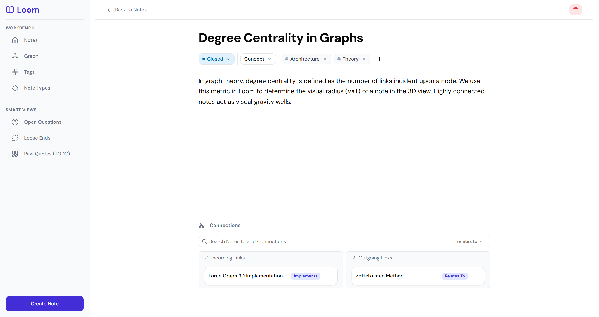
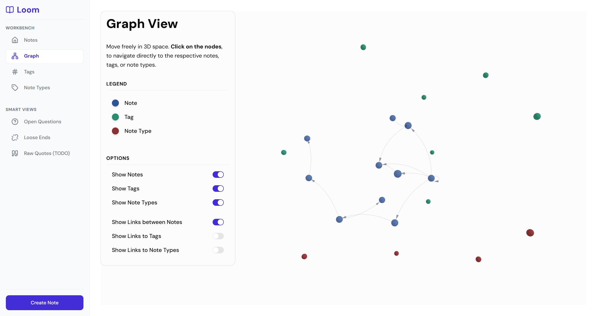
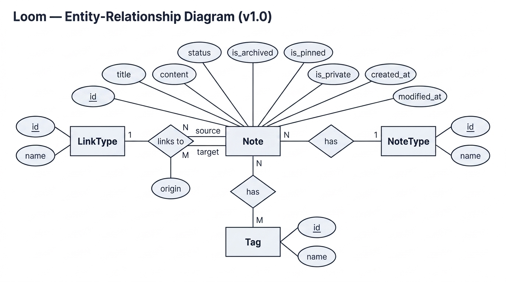

# Loom

Personal note-taking and knowledge-management app built around **open questions** and **connected thinking**. Capture notes in Markdown, organize them by type, tags, and status, link related ideas bidirectionally, and explore the entire network in an interactive 3D graph.

> **v1.0** — Complete full-stack release (CRUD, search & filtering, open-question tracking, bidirectional links, 3D graph visualization, CI, and live demo). Built intentionally without AI/LLM code generation as a hands-on full-stack & database-design project (see [`docs/learnings.md`](docs/learnings.md)).

## Live Demo

**[Launch Live Demo](https://loom-loom19.vercel.app/)** (public instance with sample data)

*Note: The backend runs on a free Render instance that spins down after inactivity, so the initial request may take up to 60 seconds. The demo database resets and re-seeds on restart/reset.*

## Features

* **Rich-Text / Markdown Editor:** Tiptap WYSIWYG editor with Markdown persistence and debounced autosave.
* **Organization & Retrieval:** Custom note types, tags, status (`open` / `ongoing` / `closed` / `none`), pinning, archiving, and composable filtering + full-text search.
* **Open Questions Focus:** Dedicated view for tracking open items and resolving them via linked notes.
* **Bidirectional Linking:** Typed manual links between notes with incoming/outgoing backlink navigation.
* **3D Knowledge Graph:** Interactive `react-force-graph-3d` visualization of notes, tags, note types, and links with layer filters and hover inspection.

## Screenshots

| Notes & Editor | 3D Knowledge Graph |
|---|---|
|  |  |

## Architecture & Data Model

* **Backend (`backend/`):** Domain-driven FastAPI modules (`notes`, `links`, `graph`), SQLAlchemy 2.0 ORM, Alembic migrations, Pydantic v2 schemas, and Pytest integration tests.
* **Frontend (`frontend/`):** Feature-based React + TypeScript (`strict`) architecture with TanStack Query for server state, Tailwind CSS, shadcn/ui, and Tiptap.



## Tech Stack

| Layer | Technology |
|---|---|
| Backend | Python 3.12, FastAPI, SQLAlchemy 2.0, Alembic, Pydantic |
| Database | PostgreSQL (Docker for local dev, Render in demo) |
| Frontend | React 19, TypeScript, Vite, Tailwind CSS, shadcn/ui, TanStack Query, Tiptap, `react-force-graph-3d` |
| Testing & CI | Pytest, ESLint, TypeScript (`tsc -b`), GitHub Actions |
| Deployment | Vercel (Frontend), Render (Backend & PostgreSQL) |

## Local Setup

### 1. Database (optional via Docker)

```bash
docker compose up -d
```

### 2. Backend

```bash
cd backend
python -m venv venv
source venv/bin/activate  # Windows: venv\Scripts\activate
pip install -r requirements.txt
cp .env.example .env      # configure DATABASE_URL (and TEST_DATABASE_URL for pytest)
alembic upgrade head
uvicorn core.main:app --reload
```

API docs are available at `http://127.0.0.1:8000/docs`. Run tests with `pytest` inside `backend/`.

### 3. Frontend

```bash
cd frontend
npm install
npm run dev
```

Runs at `http://localhost:5173`.

## Documentation

* [`docs/concept.md`](docs/concept.md) — initial use cases, requirements, and product design
* [`docs/learnings.md`](docs/learnings.md) — technical learnings across backend, frontend, and workflow
